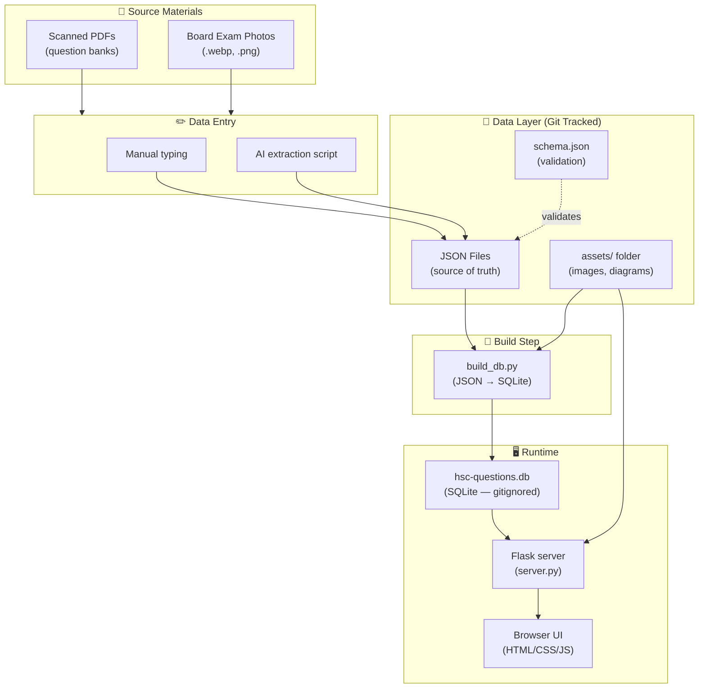
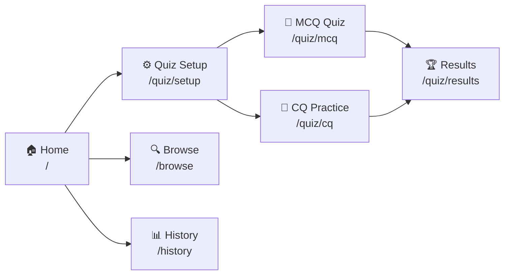
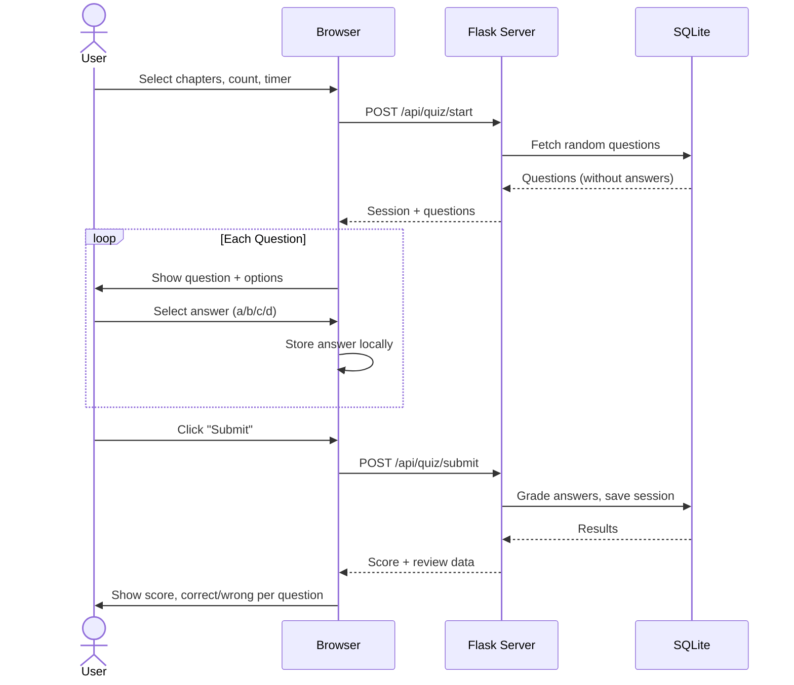
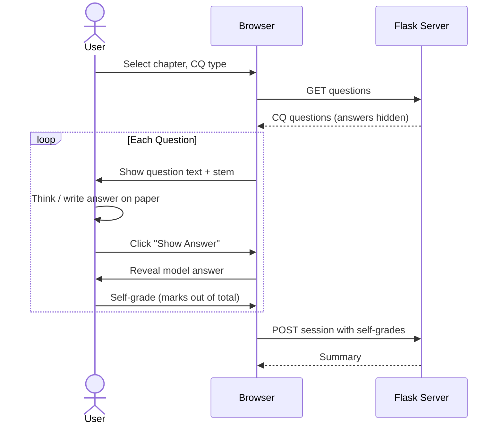

# HSC Question Bank — System Design

> The single source of truth for how this project is structured, how data flows,
> and how every component fits together.

---

## 1. Project Overview

A local web-based quiz system for Bangladesh HSC exam preparation. Questions are
extracted from scanned PDF question banks, stored as structured JSON files (source
of truth), compiled into a SQLite database (runtime), and served through a local
web app for test-taking and review.

### Goals

- Digitize MCQ and CQ questions from HSC board exams (all boards, all years)
- Support **multiple subjects** (ICT first, then Physics, Chemistry, etc.)
- Handle questions with **text, images, diagrams, code snippets, math, tables**
- Provide a **quiz interface** with scoring, timer, and review
- Track **test history** and performance over time
- Keep data **git-friendly** and easy to edit/extend

---

## 2. Architecture



### Data Flow Summary

| Step | What | How |
|------|------|-----|
| **1. Extract** | Get questions from scanned PDFs | Manual typing or AI-assisted extraction |
| **2. Store** | Save as structured JSON + image assets | Edit JSON files directly, git commit |
| **3. Build** | Compile JSON → SQLite | Run `python build_db.py` |
| **4. Serve** | Launch local web app | Run `python server.py` → open browser |
| **5. Quiz** | Take tests, see scores | Interact with web UI |

---

## 3. Directory Structure

```
hsc-materials/
│
├── system-design.md              ← This file
├── README.md                     ← Quick start guide
├── requirements.txt              ← Runtime deps (flask, jsonschema)
├── requirements-dev.txt          ← + pillow/numpy for cropping scanned diagrams
├── .gitignore                    ← Ignore .db, .venv, __pycache__, etc.
├── .venv/                        ← Local virtualenv (gitignored)
│
├── data/                         ← 📁 ALL question data (git tracked)
│   ├── schema.json               ← JSON Schema for validation
│   │
│   ├── ICT/
│   │   ├── meta.json             ← Subject metadata (chapters list, etc.)
│   │   ├── chapter-1/
│   │   │   ├── mcq.json          ← MCQ questions + answers
│   │   │   ├── cq-short.json     ← 1 & 2 mark CQ questions + answers
│   │   │   └── cq-analytical.json← Multi-part CQ questions + answers
│   │   ├── chapter-2/
│   │   │   └── ...
│   │   ├── chapter-3/
│   │   │   └── ...
│   │   ├── chapter-4/
│   │   │   └── ...
│   │   ├── chapter-5/
│   │   │   └── ...
│   │   ├── chapter-6/            ← Database Management System
│   │   │   └── ...
│   │   └── assets/               ← Images referenced by questions
│   │       ├── ch1-mcq-015.png
│   │       ├── ch3-cq-007-stem.png
│   │       └── ...
│   │
│   ├── Physics/                  ← Future subject (same structure)
│   │   └── ...
│   └── Chemistry/
│       └── ...
│
├── scripts/                      ← 🔧 Utility scripts
│   ├── common.py                 ← Shared paths / JSON loaders
│   ├── build_db.py               ← JSON → SQLite compiler
│   ├── validate.py               ← Validate JSON against schema
│   └── (extract_questions.py)    ← Planned; extraction is currently done by Claude reading the scans
│
├── app/                          ← 🖥️ Web application
│   ├── server.py                 ← Flask backend (API + page routes)
│   ├── db.py                     ← Database access layer
│   ├── static/
│   │   ├── css/style.css
│   │   └── js/                   ← app.js (shared), setup.js, quiz-mcq.js, quiz-cq.js, results.js
│   └── templates/
│       ├── base.html             ← Shared layout
│       ├── _question.html        ← Shared question renderer (macros)
│       ├── index.html            ← Dashboard / home
│       ├── quiz-setup.html       ← Configure quiz (subject, chapter, count)
│       ├── quiz-mcq.html         ← MCQ test interface
│       ├── quiz-cq.html          ← CQ practice interface
│       ├── results.html          ← Score + review after test
│       ├── history.html          ← Past test results
│       └── browse.html           ← Browse/search all questions
│
├── hsc-questions.db              ← 🗄️ Generated SQLite (GITIGNORED)
│
└── ICT/                          ← 📄 Original PDFs (reference only)
    ├── 816368802-Hsc-24-Ict-Question-Bank-1.pdf
    └── board-questions/
        ├── CHP-1-Board-MCQ-Hsc-24-Ict-Question-Bank.pdf
        ├── CHP-1-Board-CQ-1&2Mark-Questons-Hsc-24-Ict-Question-Bank.pdf
        ├── ...
        ├── hse-25-mcq-dhaka-board-1.webp
        └── hse-25-mcq-dhaka-board-2.webp
```

---

## 4. Data Schemas

### 4.1 Subject Metadata — `meta.json`

Each subject folder has a `meta.json` describing its structure.

```json
{
  "subject_id": "ict",
  "subject_name": "তথ্য ও যোগাযোগ প্রযুক্তি",
  "subject_name_en": "ICT",
  "subject_code": 275,
  "total_chapters": 6,
  "chapters": [
    {
      "number": 1,
      "name": "তথ্য ও যোগাযোগ প্রযুক্তি: বিশ্ব ও বাংলাদেশ প্রেক্ষিত",
      "name_en": "ICT: World and Bangladesh Perspective"
    },
    {
      "number": 2,
      "name": "কমিউনিকেশন সিস্টেমস ও নেটওয়ার্কিং",
      "name_en": "Communication Systems & Networking"
    },
    {
      "number": 3,
      "name": "সংখ্যা পদ্ধতি ও ডিজিটাল ডিভাইস",
      "name_en": "Number Systems & Digital Devices"
    },
    {
      "number": 4,
      "name": "ওয়েব ডিজাইন পরিচিতি ও HTML",
      "name_en": "Web Design Introduction & HTML"
    },
    {
      "number": 5,
      "name": "প্রোগ্রামিং ভাষা",
      "name_en": "Programming Language"
    },
    {
      "number": 6,
      "name": "ডেটাবেজ ম্যানেজমেন্ট সিস্টেম",
      "name_en": "Database Management System"
    }
  ],
  "boards": [
    { "code": "ALL", "name": "সকল বোর্ড (অভিন্ন প্রশ্ন)" },
    { "code": "DB", "name": "ঢাকা বোর্ড" },
    { "code": "RB", "name": "রাজশাহী বোর্ড" },
    { "code": "CB", "name": "চট্টগ্রাম বোর্ড" },
    { "code": "JB", "name": "যশোর বোর্ড" },
    { "code": "SB", "name": "সিলেট বোর্ড" },
    { "code": "BB", "name": "বরিশাল বোর্ড" },
    { "code": "DIB", "name": "দিনাজপুর বোর্ড" },
    { "code": "CUB", "name": "কুমিল্লা বোর্ড" },
    { "code": "MB", "name": "ময়মনসিংহ বোর্ড" },
    { "code": "MAD", "name": "মাদ্রাসা বোর্ড" }
  ],
  "years_available": ["2016", "2017", "2018", "2019", "2023", "2025", "2026"]
}
```

### 4.2 MCQ Questions — `mcq.json`

```json
{
  "subject": "ict",
  "chapter": 1,
  "type": "mcq",
  "questions": [
    {
      "id": "ict-ch1-mcq-001",
      "text": "টেলিমেডিসিনের প্রয়োগক্ষেত্র কোনটি?",
      "text_en": null,
      "image": null,
      "options": [
        { "label": "a", "text": "কারখানার্তারি", "image": null },
        { "label": "b", "text": "বায়োমেট্রিক্স", "image": null },
        { "label": "c", "text": "ভার্চুয়াল রিয়েলিটি", "image": null },
        { "label": "d", "text": "আর্টিফিশিয়াল ইন্টেলিজেন্ট", "image": null }
      ],
      "answer": "c",
      "explanation": null,
      "source": {
        "board": "DB",
        "year": "2023",
        "session": null
      },
      "tags": ["nanotechnology", "application"],
      "difficulty": null
    },
    {
      "id": "ict-ch1-mcq-002",
      "text": "AI এর ক্ষেত্রগুলো হলো—",
      "text_en": null,
      "image": null,
      "statements": [
        { "label": "i", "text": "মেশিন লার্নিং" },
        { "label": "ii", "text": "রোবটিক্স" },
        { "label": "iii", "text": "ডার্ট প্রসেসিং" }
      ],
      "options": [
        { "label": "a", "text": "i, ii", "image": null },
        { "label": "b", "text": "i, iii", "image": null },
        { "label": "c", "text": "ii, iii", "image": null },
        { "label": "d", "text": "i, ii, iii", "image": null }
      ],
      "answer": "d",
      "explanation": null,
      "source": { "board": "Ctg.B", "year": "2023" },
      "tags": [],
      "difficulty": null
    },
    {
      "id": "ict-ch3-mcq-045",
      "text": "উদ্দীপকের Y এর সমীকরণ কোনটি?",
      "text_en": null,
      "image": "assets/ch3-mcq-045-circuit.png",
      "options": [
        { "label": "a", "text": "A̅B + AB", "image": null },
        { "label": "b", "text": "A̅B + A̅B̅", "image": null },
        { "label": "c", "text": "A · B", "image": null },
        { "label": "d", "text": "A + B", "image": null }
      ],
      "answer": "b",
      "explanation": null,
      "source": { "board": "DB", "year": "2025" },
      "tags": ["logic-gate", "boolean"],
      "difficulty": null
    }
  ]
}
```

> **Fields added during implementation** (all optional, see `data/schema.json`):
> - `stem` / `stem_image` — shared উদ্দীপক for grouped questions (e.g. "answer Q19 and Q20").
>   Each question in the group **carries its own copy**; `group` (e.g. `"hse26-q19-20"`) links them.
>   Code stems keep their newlines and are shown monospaced.
> - Chapter-wise question-bank PDFs (mixed boards/years, e.g. `ICT/mcq/CHP-N-*.pdf`): `source.board`/`year`
>   hold the *first* board tag printed after the question (e.g. `[DB, SB, MB'23]` → DB 2023); `qno` is the
>   number in that booklet chapter, `group` ids look like `bank-ch3-db23-q2`. Questions repeated across boards
>   are stored once. Items with no correct option in the printed key were not imported.
> - `source.qno` (question number in the scan it came from; an audit pointer only).
>   The paper *set* (ক/খ/গ/ঘ) is deliberately **not** stored: all sets contain the same questions, just shuffled.
>   `source.board` may be `"ALL"` for the 2026 paper, which is identical for every board.
> - `review_note` — an open doubt about transcription or about the printed answer key.
>   The question is flagged ⚠ in the UI; `validate.py` lists these as warnings.
> - Overlines (Ā, A·B̄) are typed with Unicode combining overline characters (U+0305).
>
> **Answer keys are copied from the source scans.** Where the printed key disagrees with a
> hand check, the source key is kept and the doubt goes in `review_note`.
>
> **Note on `image` fields:**
> - `null` → no image, text only
> - `"assets/ch3-mcq-045-circuit.png"` → relative path from the subject folder
> - Can appear on question, individual options, or explanations
> - The same image path system works in stems, answers, and CQ parts

### 4.3 Short CQ Questions — `cq-short.json`

```json
{
  "subject": "ict",
  "chapter": 1,
  "type": "cq_short",
  "questions": [
    {
      "id": "ict-ch1-cqs-001",
      "text": "ন্যানোটেকনোলজি কী?",
      "text_en": "What is Nanotechnology?",
      "image": null,
      "marks": 1,
      "answer": "বিজ্ঞানের যে শাখায় ন্যানোপার্টিকেলস নিয়ে গবেষণা করা হয়, বৈশিষ্ট্য, আকৃতি-প্রকৃতি পরিবর্তন ও এদের প্রয়োগ নিয়ে আলোচনা করা হয়, তাকেই ন্যানোটেকনোলজি বলে।",
      "answer_image": null,
      "source": {
        "board": "DB",
        "year": "2023"
      },
      "tags": ["definition", "nanotechnology"]
    },
    {
      "id": "ict-ch1-cqs-002",
      "text": "CAD কী?",
      "text_en": "What is CAD?",
      "image": null,
      "marks": 1,
      "answer": "CAD হলো Computer Aided Design।",
      "answer_image": null,
      "source": { "board": "DB", "year": "2023" },
      "tags": ["definition", "cad"]
    }
  ]
}
```

### 4.4 Analytical CQ Questions — `cq-analytical.json`

```json
{
  "subject": "ict",
  "chapter": 1,
  "type": "cq_analytical",
  "questions": [
    {
      "id": "ict-ch1-cqa-001",
      "stem": "রহিম সাহেব একটি কোম্পানিতে কর্মরত। তিনি অফিসের নিরাপত্তা ব্যবস্থায় আঙুলের ছাপ ব্যবহার করে প্রবেশ করেন...",
      "stem_en": null,
      "stem_image": null,
      "parts": [
        {
          "label": "ক",
          "text": "ক্রায়োসার্জারি কী?",
          "marks": 1,
          "bloom_level": "knowledge",
          "answer": "ক্রায়োসার্জারি হলো এমন একটি চিকিৎসা পদ্ধতি যেখানে অত্যধিক শীতল তাপমাত্রা প্রয়োগ করে অস্বাভাবিক বা রোগাক্রান্ত টিস্যু ধ্বংস করা হয়।",
          "answer_image": null
        },
        {
          "label": "খ",
          "text": "বায়োইনফরমেটিক্স পদ্ধতিতে ও বায়োমেট্রিক্স ব্যাখ্যা কর।",
          "marks": 2,
          "bloom_level": "understanding",
          "answer": "বায়োমেট্রিক্স প্রযুক্তি বলতে...",
          "answer_image": null
        },
        {
          "label": "গ",
          "text": "উদ্দীপকে রহিম সাহেবের ব্যবহৃত প্রযুক্তিটি ব্যাখ্যা কর।",
          "marks": 3,
          "bloom_level": "application",
          "answer": "উদ্দীপকে রহিম সাহেব...",
          "answer_image": null
        },
        {
          "label": "ঘ",
          "text": "উক্ত প্রযুক্তির সুবিধা ও সীমাবদ্ধতা বিশ্লেষণ কর।",
          "marks": 4,
          "bloom_level": "analysis",
          "answer": "ফিঙ্গারপ্রিন্ট স্ক্যানিং প্রযুক্তির সুবিধা...",
          "answer_image": null
        }
      ],
      "total_marks": 10,
      "source": { "board": "DB", "year": "2023" },
      "tags": ["biometrics", "cryosurgery"]
    }
  ]
}
```

### 4.5 Image Conventions

| Scenario | `image` field value | File location |
|----------|-------------------|---------------|
| No image | `null` | — |
| Question has diagram | `"assets/ch3-mcq-045-circuit.png"` | `data/ICT/assets/ch3-mcq-045-circuit.png` |
| Option has image | option's `"image": "assets/ch2-mcq-012-opt-a.png"` | `data/ICT/assets/ch2-mcq-012-opt-a.png` |
| CQ stem diagram | `"stem_image": "assets/ch1-cqa-003-stem.png"` | same pattern |
| Answer has image | `"answer_image": "assets/ch1-cqs-005-ans.png"` | same pattern |
| Entire question is image | `"text": "[image-only question]"`, `"image": "assets/..."` | same pattern |

**Image naming convention:** `ch{chapter}-{type}-{number}[-part].png`

Examples:
- `ch3-mcq-045-circuit.png`
- `ch1-cqa-003-stem.png`
- `ch5-mcq-012-opt-b.png`
- `ch2-cqa-007-ans-গ.png`

---

## 5. SQLite Database Schema

The SQLite database is **auto-generated** from JSON files by `build_db.py`.
It is gitignored and can always be rebuilt.

```sql
-- Core tables
CREATE TABLE subjects (
    id          TEXT PRIMARY KEY,      -- "ict", "physics"
    name        TEXT NOT NULL,          -- "তথ্য ও যোগাযোগ প্রযুক্তি"
    name_en     TEXT,                   -- "ICT"
    code        INTEGER                 -- 275
);

CREATE TABLE chapters (
    id          TEXT PRIMARY KEY,       -- "ict-ch1"
    subject_id  TEXT NOT NULL REFERENCES subjects(id),
    number      INTEGER NOT NULL,
    name        TEXT NOT NULL,
    name_en     TEXT
);

-- Questions (all types in one table, discriminated by `type`)
CREATE TABLE questions (
    id          TEXT PRIMARY KEY,       -- "ict-ch1-mcq-001"
    chapter_id  TEXT NOT NULL REFERENCES chapters(id),
    type        TEXT NOT NULL,          -- "mcq" | "cq_short" | "cq_analytical"
    text        TEXT,                   -- Question text (Bangla)
    text_en     TEXT,                   -- Optional English text
    image       TEXT,                   -- Relative path to image or NULL
    board       TEXT,                   -- "DB", "RB", etc.
    year        TEXT,                   -- "2023"
    marks       INTEGER,               -- Total marks (for CQ)
    difficulty  TEXT,                   -- "easy" | "medium" | "hard" | NULL
    tags        TEXT,                   -- JSON array as text: '["tag1","tag2"]'
    review_note TEXT,                   -- NULL unless flagged for review
    extra_json  TEXT                    -- stem, stem_image, statements, group, source_qno,
                                        -- explanation; for cq_short also answer / answer_image
);

-- MCQ options (only for type="mcq")
CREATE TABLE mcq_options (
    id          INTEGER PRIMARY KEY AUTOINCREMENT,
    question_id TEXT NOT NULL REFERENCES questions(id),
    label       TEXT NOT NULL,          -- "a", "b", "c", "d"
    text        TEXT,
    image       TEXT,                   -- Image path or NULL
    is_correct  BOOLEAN NOT NULL DEFAULT 0
);

-- CQ parts (only for type="cq_analytical")
CREATE TABLE cq_parts (
    id          INTEGER PRIMARY KEY AUTOINCREMENT,
    question_id TEXT NOT NULL REFERENCES questions(id),
    label       TEXT NOT NULL,          -- "ক", "খ", "গ", "ঘ"
    text        TEXT NOT NULL,
    marks       INTEGER NOT NULL,
    bloom_level TEXT,                   -- "knowledge", "understanding", etc.
    answer      TEXT,
    answer_image TEXT
);

-- Test history (populated by the quiz app at runtime).
-- build_db.py copies these two tables over from the old DB, so rebuilding never loses history.
-- test_answers.question_id has no FK on purpose: history survives question edits/removals.
CREATE TABLE test_sessions (
    id          INTEGER PRIMARY KEY AUTOINCREMENT,
    started_at  TEXT NOT NULL,          -- ISO 8601
    finished_at TEXT,
    subject_id  TEXT REFERENCES subjects(id),
    mode        TEXT NOT NULL,          -- "mcq" | "cq_short" | "cq_analytical"
    chapters    TEXT NOT NULL,          -- JSON array: [1, 3]
    total_questions INTEGER NOT NULL,
    correct     INTEGER,
    score_pct   REAL,
    time_taken  INTEGER,               -- seconds
    config_json TEXT                    -- Quiz config (timer, random order, etc.)
);

CREATE TABLE test_answers (
    id          INTEGER PRIMARY KEY AUTOINCREMENT,
    session_id  INTEGER NOT NULL REFERENCES test_sessions(id),
    question_id TEXT NOT NULL,
    given_answer TEXT,                  -- "a", "b", etc. or free text
    is_correct  BOOLEAN,
    time_spent  INTEGER,               -- seconds on this question
    self_grade  INTEGER                -- For CQ: self-assessed marks
);

-- Indexes for performance
CREATE INDEX idx_questions_chapter ON questions(chapter_id);
CREATE INDEX idx_questions_type ON questions(type);
CREATE INDEX idx_questions_board_year ON questions(board, year);
CREATE INDEX idx_mcq_options_question ON mcq_options(question_id);
CREATE INDEX idx_cq_parts_question ON cq_parts(question_id);
CREATE INDEX idx_test_answers_session ON test_answers(session_id);
CREATE INDEX idx_test_sessions_subject ON test_sessions(subject_id);

-- Full-text search on question text
CREATE VIRTUAL TABLE questions_fts USING fts5(
    id, text, text_en, tags,
    content='questions',
    content_rowid='rowid'
);
```

---

## 6. Web App Design

### 6.1 Tech Stack

| Layer | Technology | Why |
|-------|-----------|-----|
| **Backend** | Python + Flask | Simple, no build step, good SQLite support |
| **Frontend** | Vanilla HTML/CSS/JS | No framework overhead, works offline |
| **Database** | SQLite | Single file, zero config, fast |
| **Styling** | Simple CSS (or Pico CSS) | Clean, minimal, responsive |
| **Images** | Static file serving | Flask serves from `data/*/assets/` |

No npm, no webpack, no React. Just `python server.py` and open browser.

### 6.2 Pages & Routes



| Route | Method | Description |
|-------|--------|-------------|
| `GET /` | — | Dashboard: stats, **needs attention** (unfinished quizzes, weak chapters <60%, often-missed questions, chapters never tested), recent tests, content health |
| `GET /quiz/setup` | — | Pick subject, chapters, question count, mode |
| `POST /quiz/start` | JSON | Start a quiz session, returns question IDs |
| `GET /quiz/mcq/<session_id>` | — | MCQ test page |
| `GET /quiz/cq/<session_id>` | — | CQ practice page |
| `POST /quiz/submit` | JSON | Submit answers, returns results |
| `GET /quiz/results/<session_id>` | — | Review results + correct answers |
| `GET /browse` | — | Browse/filter all questions |
| `GET /history` | — | Past test sessions + stats |
| `POST /quiz/discard/<session_id>` | — | Delete an *unfinished* session (finished history is never deleted) |
| `GET /api/questions` | JSON | API: filter questions (for AJAX) |
| `GET /api/stats` | JSON | API: performance stats |
| `GET /media/<subject_id>/<path>` | — | Serve question images (`/media/ict/assets/ch3-mcq-004-stem.png`) |

### 6.3 API Endpoints

```
GET /api/questions?subject=ict&chapter=1,3&type=mcq&board=DB&year=2023&limit=25&random=true
→ Returns list of questions matching filters

POST /api/quiz/start
  Body: { "subject": "ict", "chapters": [1,3], "type": "mcq", "count": 25, "timed": true, "time_minutes": 25 }
→ Returns: { "session_id": 42, "questions": [...] }

POST /api/quiz/submit
  Body: { "session_id": 42, "answers": [{"question_id": "ict-ch1-mcq-001", "answer": "c", "time_spent": 12}, ...] }
→ Returns: { "score": 20, "total": 25, "percentage": 80.0, "review": [...] }

GET /api/stats?subject=ict
→ Returns: { "total_tests": 15, "avg_score": 72.5, "by_chapter": {...}, "recent": [...] }
```

### 6.4 Quiz Flow

#### MCQ Mode



#### CQ Mode



---

## 7. Build Pipeline

### `build_db.py` — JSON → SQLite

This script reads all JSON files from `data/` and populates `hsc-questions.db`.

**Responsibilities:**
1. Build a fresh DB (`hsc-questions.db.new`), then atomically swap it in; carry over `test_sessions` / `test_answers`
2. Create all tables (schema above)
3. Walk `data/*/meta.json` → populate `subjects` and `chapters`
4. Walk `data/*/chapter-*/mcq.json` → populate `questions` + `mcq_options`
5. Walk `data/*/chapter-*/cq-short.json` → populate `questions`
6. Walk `data/*/chapter-*/cq-analytical.json` → populate `questions` + `cq_parts`
7. Build FTS index
8. Print summary (X subjects, Y chapters, Z questions)

**Usage:**
```bash
cd hsc-materials
python scripts/build_db.py          # Rebuild database
python scripts/build_db.py --check  # Dry run, report counts only
```

### `validate.py` — Schema Validation

Validates all JSON files against `data/schema.json`:
- JSON Schema (`data/schema.json`, via `jsonschema`)
- Required fields present
- IDs are unique across entire dataset
- Image paths point to existing files
- Answer labels match option labels
- Chapter numbers match meta.json

```bash
python scripts/validate.py           # Validate everything
python scripts/validate.py data/ICT  # Validate one subject
```

---

## 8. ID Convention

All question IDs follow a deterministic pattern:

```
{subject}-ch{chapter}-{type}-{number}
```

| Component | Values | Example |
|-----------|--------|---------|
| subject | `ict`, `physics`, `chemistry`, etc. | `ict` |
| chapter | 1-digit or 2-digit | `ch1`, `ch12` |
| type | `mcq`, `cqs` (short), `cqa` (analytical) | `mcq` |
| number | 3-digit zero-padded | `001`, `042`, `117` |

**Examples:**
- `ict-ch1-mcq-001` — ICT Chapter 1, MCQ #1
- `ict-ch3-cqs-015` — ICT Chapter 3, Short CQ #15
- `physics-ch7-cqa-003` — Physics Chapter 7, Analytical CQ #3

---

## 9. Adding a New Subject

To add a new subject (e.g., Physics):

1. Create the folder structure:
   ```
   data/Physics/
   ├── meta.json         ← Fill in chapters, boards
   ├── chapter-1/
   │   ├── mcq.json      ← Start with empty: {"subject":"physics","chapter":1,"type":"mcq","questions":[]}
   │   ├── cq-short.json
   │   └── cq-analytical.json
   ├── chapter-2/
   │   └── ...
   └── assets/
   ```

2. Populate `meta.json` with chapter names, board info

3. Add questions to the JSON files (manually or via AI extraction)

4. Run `python scripts/validate.py data/Physics`

5. Run `python scripts/build_db.py` to rebuild the database

6. Questions appear automatically in the web app

---

## 10. Future Enhancements

These are **not in scope** for v1, but the design supports them:

| Feature | How |
|---------|-----|
| **Spaced repetition** | Add `next_review_date` + `ease_factor` columns to a new table, Anki-style algorithm |
| **Board-wise mock test** | Filter by board, enforce real exam structure (25 MCQ + CQ set) |
| **Chapter-wise weakness** | Already tracked via `test_answers` — just build the analytics query |
| **Export to Anki** | Script to convert JSON → Anki `.apkg` format |
| **Multi-user** | Add `users` table, session auth — but overkill for personal use |
| **Mobile PWA** | Add `manifest.json` + service worker for offline use on phone |
| **AI grading for CQ** | Send written answer + model answer to Gemini API for feedback |

---

## 11. Tech Decisions Log

| Decision | Chosen | Alternatives Considered | Reason |
|----------|--------|------------------------|--------|
| Source of truth | JSON files | Markdown, YAML, direct SQLite | Git-friendly, structured, easy to edit |
| Runtime DB | SQLite | PostgreSQL, JSON in memory | Zero config, single file, plenty fast |
| Backend | Flask | FastAPI, Django, Node.js | Simplest for local app, great template support |
| Frontend | Vanilla JS | React, Vue, Svelte | No build step, works offline, minimal complexity |
| Image storage | Separate files | Base64 in JSON, SQLite blobs | Keeps JSON small, easy to view/replace images |
| Styling | Custom CSS (light/dark) | Pico CSS, Tailwind, Bootstrap | No CDN, works offline |
| Quiz rendering | Server-rendered; JS only for navigation/timer | Client-side SPA | Answers never reach the browser during an MCQ quiz |
| Shared stems | Copied into each question + `group` id | Separate stems table | Keeps each question self-contained and JSON simple |
| Answer key conflicts | Keep source key + `review_note` | Silently "correct" it | Source of truth stays auditable; user decides |

---

## 12. Getting Started (Quick Reference)

```bash
# First time setup
cd hsc-materials
python3 -m venv .venv && .venv/bin/pip install -r requirements.txt
source .venv/bin/activate

# Add/edit questions
# Edit data/ICT/chapter-1/mcq.json (or any JSON file)

# Validate
python scripts/validate.py

# Build database
python scripts/build_db.py

# Run app
python app/server.py
# → Open http://localhost:5000
```

